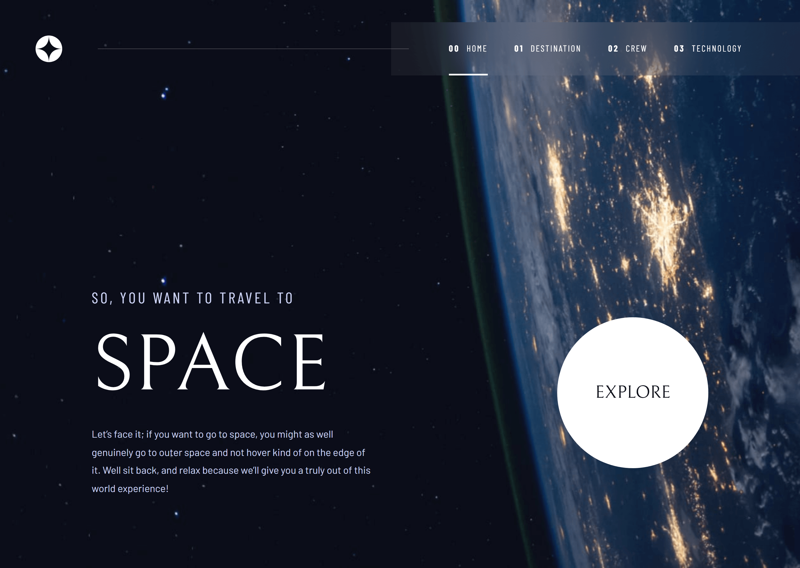
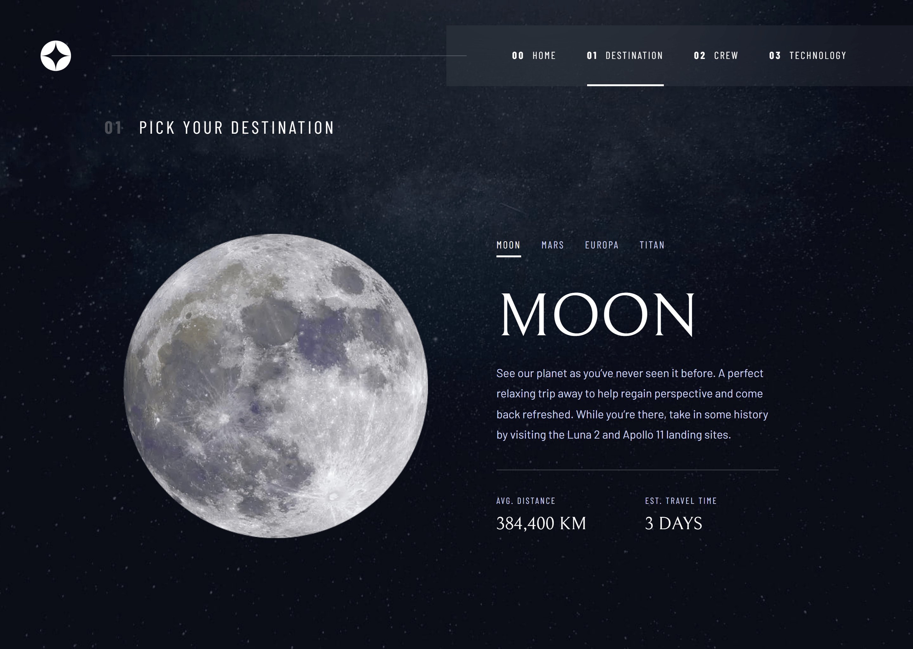
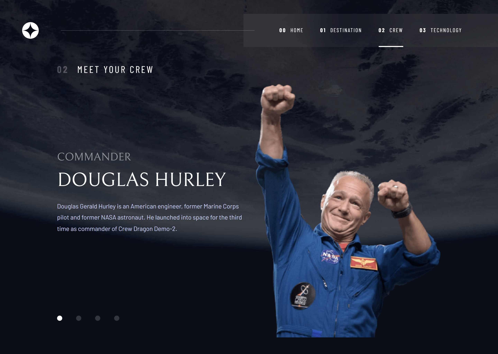
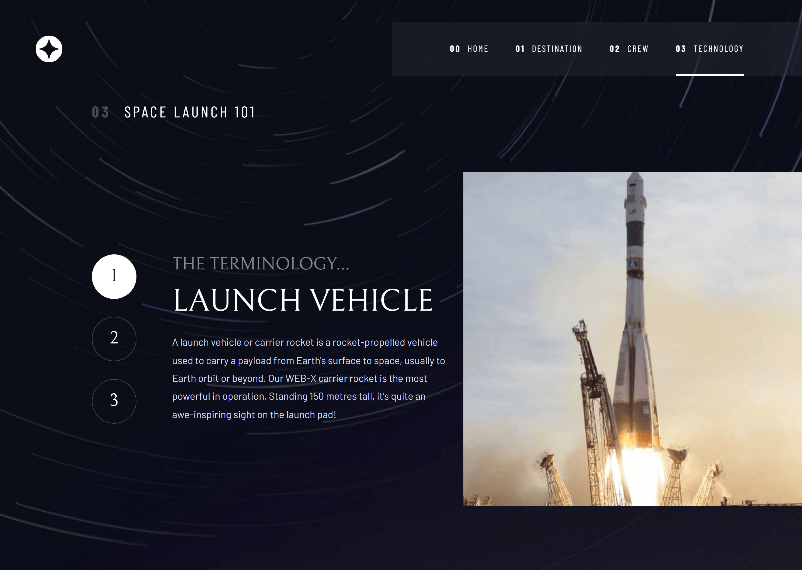

# Frontend Mentor - Space tourism website solution

This is a solution to the [Space tourism website challenge on Frontend Mentor](https://www.frontendmentor.io/challenges/space-tourism-multipage-website-gRWj1URZ3).

## Table of contents

- [Overview](#overview)
  - [The challenge](#the-challenge)
  - [Pages Screenshot](#pages-screenshot)
  - [Links](#links)
- [My process](#my-process)
  - [Built with](#built-with)
  - [What I learned](#what-i-learned)
  - [Useful resources](#useful-resources)
- [Author](#author)

## Overview

### The challenge

Users should be able to:

- View the optimal layout for each of the website's pages depending on their device's screen size
- See hover states for all interactive elements on the page
- View each page and be able to toggle between the tabs to see new information

### Pages Screenshot

|                                  Home Page                                   |                                      Destination Page                                      |
| :--------------------------------------------------------------------------: | :----------------------------------------------------------------------------------------: |
|  |  |

|                                  Crew Page                                   |                                     Technology Page                                      |
| :--------------------------------------------------------------------------: | :--------------------------------------------------------------------------------------: |
|  |  |

### Links

- Solution URL: [Add solution URL here](https://your-solution-url.com)
- Live Site URL: [Add live site URL here](https://your-live-site-url.com)

## My process

### Built with

- Semantic HTML5 markup
- CSS custom properties
- Flexbox
- CSS Grid
- Mobile-first workflow
- [React](https://reactjs.org/) - JS Library
- [Vite](https://vitejs.dev/) - Next Generation Frontend Tooling
- [Material UI (MUI)](https://mui.com/) - React UI framework for components & styling
- [React Router](https://reactrouter.com/) - Declarative routing for React

### What I learned

Through building this project, I strengthened my understanding of client-side dynamic routing, handling dynamic parameters with **React Router**, efficient state management, and creating a responsive layout with custom themes using **Material UI**.

### Useful resources

- [Material UI Documentation](https://mui.com/material-ui/getting-started/) - Great resource for understanding MUI ThemeProvider and components.
- [React Router Docs](https://reactrouter.com/) - Essential guide for navigation and route parameters

## Author

- Website - [Add your name here](https://www.your-site.com)
- Frontend Mentor - [@yourusername](https://www.frontendmentor.io/profile/yourusername)
- Twitter - [@yourusername](https://www.twitter.com/yourusername)
